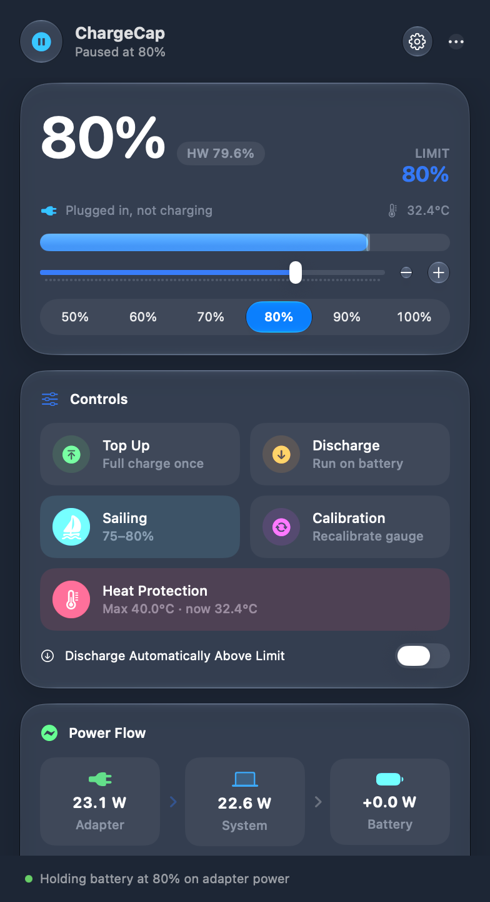
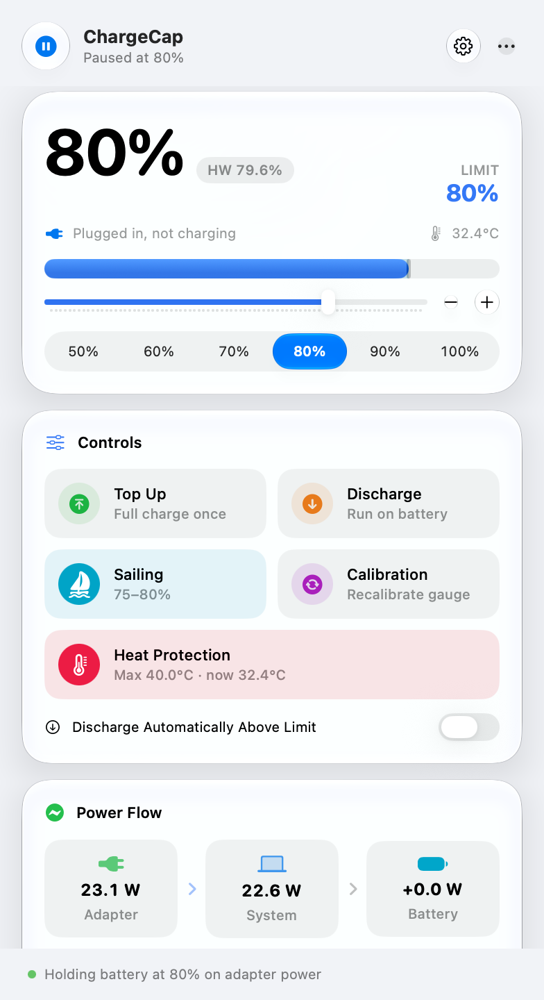
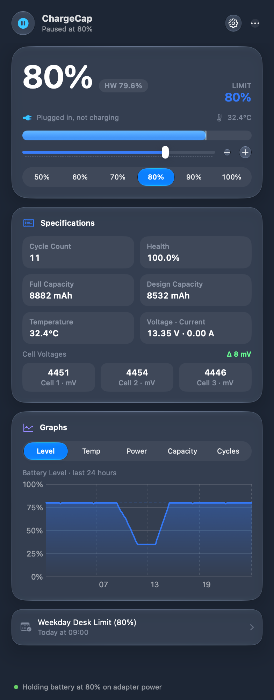
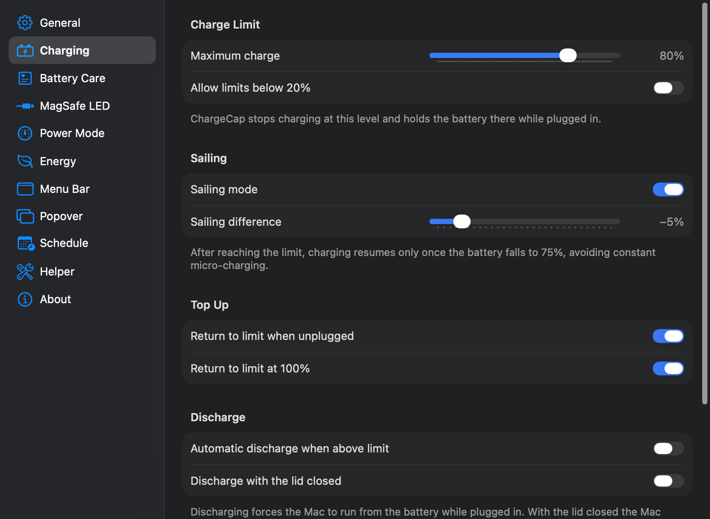
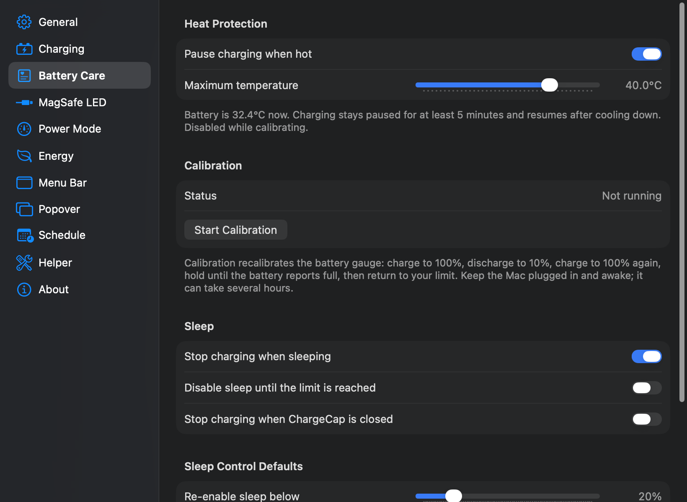
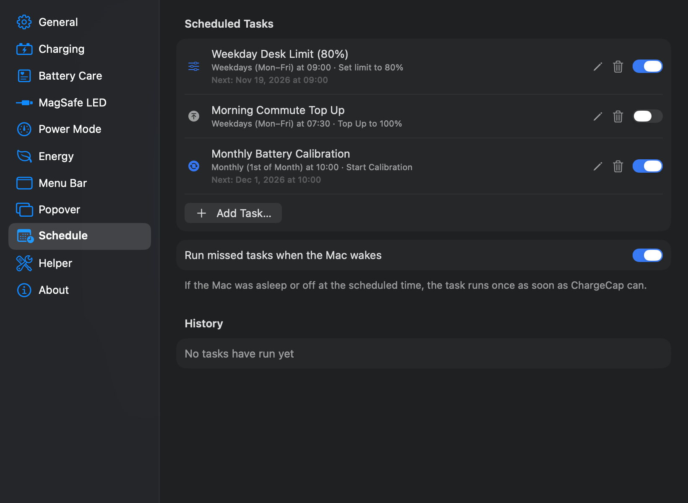
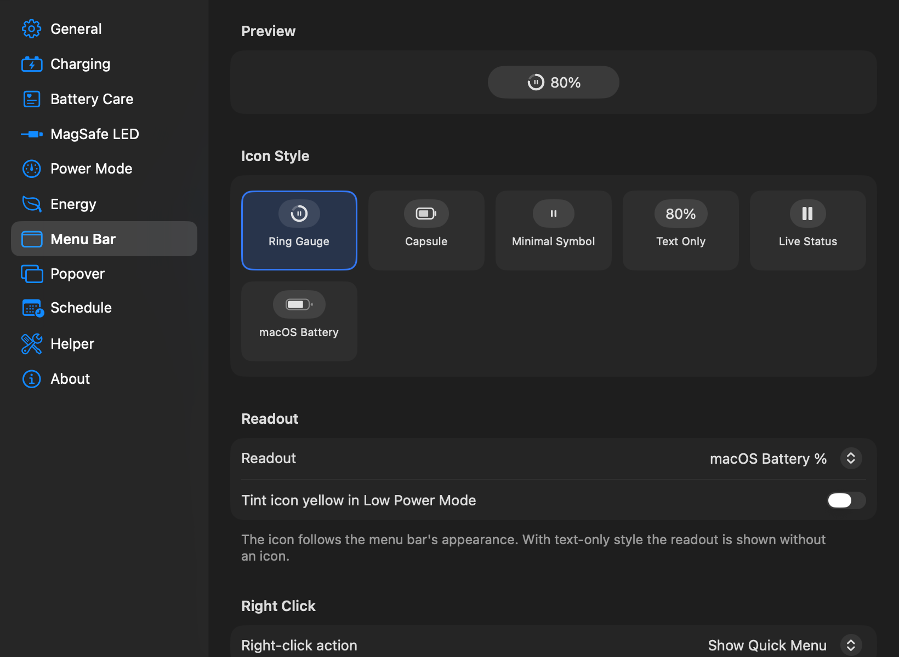
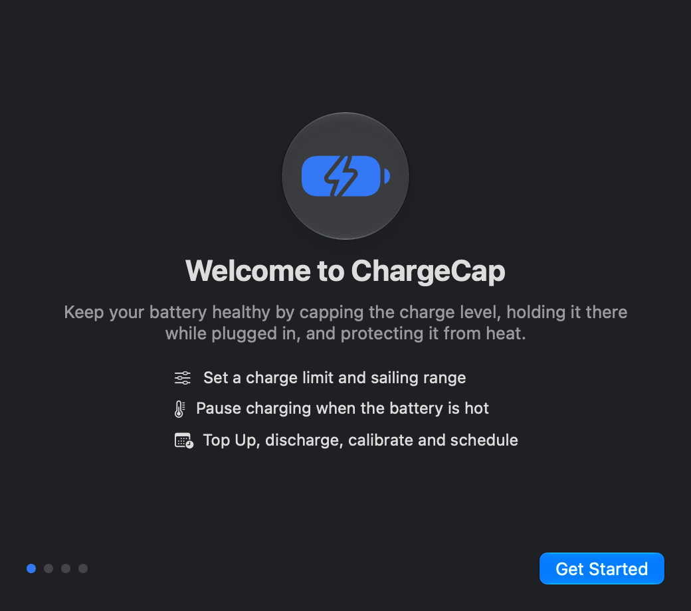
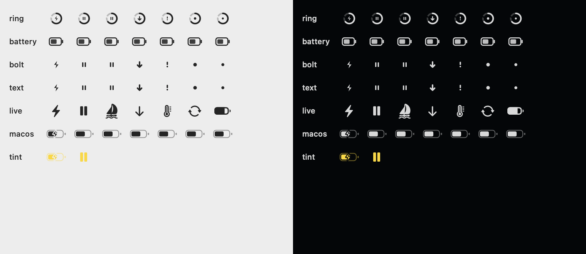

# ChargeCap

A native battery care, charge limiter, and power telemetry menu bar app for **macOS 27+** on Apple silicon MacBooks, built with Swift 6, SwiftUI, and **Liquid Glass**.

Forked from the last open-source (MIT) release of AlDente and modernized for macOS 27, aiming for feature parity with today's closed-source AlDente Pro. See [docs/IMPROVEMENT_PLAN.md](docs/IMPROVEMENT_PLAN.md) for the audit and roadmap.

<p align="center">
  
  &nbsp;
  
</p>

## Download & Install

1. Download **ChargeCap.dmg** from the [latest release](https://github.com/karimbacchus/ChargeCap/releases/latest). It's signed with Developer ID and notarized by Apple.
2. Drag **ChargeCap** into **Applications** and open it.
3. Click **Install Helper**, then switch on ChargeCap in **System Settings › General › Login Items**. Touch ID works; no password needed.
4. Turn off macOS's own **Optimized Battery Charging** / charge limit (System Settings › Battery) so the two don't fight each other.

Requires macOS 27 or later on an Apple silicon MacBook.

## Screenshots

| Stats & graphs | Charging settings |
| :---: | :---: |
|  |  |

| Battery care | Schedules |
| :---: | :---: |
|  |  |

| Menu bar | First run |
| :---: | :---: |
|  |  |

<p align="center"></p>

## Features

**Charge Control & Modes**
- **Charge Limiter (10%–100%)**: Set your maximum battery charge limit via slider, stepper, or quick preset glass pills (`50%`, `60%`, `70%`, `80%`, `90%`, `100%`).
- **Hardware BMS Percentage vs. macOS Percentage**: View and regulate charging using either the macOS UI battery percentage or the raw hardware gas-gauge ratio (`AppleRawCurrentCapacity` / `AppleRawMaxCapacity` mAh).
- **Sailing Mode**: Define a hysteresis buffer (`1%–30%`, default `-5%`) below your charge limit so the battery isn't micro-charged while plugged in.
- **Active & Automatic Discharge**: Run your MacBook on battery power even while connected to a wall charger (`CHIE` / `CH0I` adapter isolation) to actively discharge down to your target limit, with optional automatic discharge and clamshell discharge support.
- **Top Up**: One-click override that charges your MacBook to `100%` before heading out and automatically reverts to your normal charge limit at `100%` or when unplugged.
- **Calibration Mode**: Automated 5-step cycle (`100%` → `10%` → `100%` → hold until the gauge reports full (10 min–2 h) → back to your limit), persisted across restarts.
- **Heat Protection**: Pauses charging when the battery exceeds your threshold (default `35 °C`), resuming after a `2 °C` drop and at least 5 minutes; disabled during calibration.
- **Sleep & Shutdown Protection**: Stop charging before macOS sleeps, optionally prevent sleep until the charge limit is reached, and control whether SMC charge inhibit persists on quit.
- **MagSafe 3 LED Control (`ACLC`)**: Sync the physical MagSafe connector LED with ChargeCap's state (Amber while charging/topping up, Green when capped/sailing/discharging, pulsing Amber on Heat Protection), or force Green, Amber, Off (Stealth Mode), or macOS Default.

- **Sleep Control**: Keep the Mac awake for 30 min–5 h or indefinitely; re-enables sleep below a battery threshold or when unplugged.
- **Low Power Mode Control**: Always on/off, only on battery, or only on adapter (applied via `pmset` by the helper).
- **Apps Using Significant Energy**: Per-app energy impact with a Quit button.

**Power Flow & Hardware Telemetry**
- **Live Energy Routing Diagram**: Real-time wattage flow across **Adapter Input** (negotiated USB-PD voltage, current, rated wattage), **Mac System Load** (including adapter efficiency loss), **Battery Pack** (`+W` charging / `-W` discharging / bypassed), and **USB-C Ports Out**.
- **Battery Health & Cell Balance**: Live mAh capacity (`Current`, `Full Charge`, `Nominal`, `Design`), cycle count, health percentage, pack voltage, and individual cell voltages (`BC1V`, `BC2V`, `BC3V` in mV with cell delta mV).
- **Stats & History**: Persisted history (7 days of 1-minute samples, daily health forever) charted with Swift Charts: battery level vs. limit, temperature, power, maximum capacity, and cycle count.
- **Customizable Popover & Menu Bar**: Show/hide/reorder popover widgets; ring, macOS-style battery, live status, or text icon; extra readouts; Low Power Mode tint; configurable right-click action.

**Automations, Shortcuts & URL Scheme**
- **Built-in Scheduler**: Recurring tasks (Every Day, Weekdays, Weekends, Weekly, Monthly, or custom days) to change limits, Top Up, calibrate, discharge, toggle Sailing, or switch Low Power Mode, with run history and catch-up for runs missed while asleep.
- **Apple Shortcuts (`AppIntents`)**: Native actions in the macOS Shortcuts app and Spotlight (*Set Battery Charge Limit*, *Top Up Battery to 100%*, *Discharge Battery to Limit*, *Control Battery Calibration Mode*, *Configure Sailing Mode*, *Get Battery & Power Flow Status*).
- **`chargecap://` URL Scheme & CLI**:
  ```
  chargecap://set-limit?percent=80
  chargecap://top-up?enable=true
  chargecap://discharge?enable=true
  chargecap://calibrate?action=start|next|stop
  chargecap://sailing?enable=true&delta=5
  chargecap://heat-protection?enable=true&maxTemp=40
  chargecap://magsafe?mode=auto|green|orange|off|system
  ```

**Multi-Generation SMC Engine**
- Automatically detects and drives the appropriate AppleSMC register family for your Mac:
  - Apple silicon M3/M4/M5 & macOS 27 (`CHIB`, `CHIC`, `CHCE`, `CHCC`, `CHIE`, `ACLC`)
  - Apple silicon CHTE firmware (`CHTE`, `CHIE`, `ACLC`)
  - Apple silicon M1/M2 (`CH0B`, `CH0C`, `CH0I`, `CH0J`, `ACLC`)
  - Intel classic (`BCLM`, `BFCL`)

## Build from Source

Requires macOS 27 and Xcode 27:

```bash
make run       # build, bundle, sign with Developer ID, and launch build/ChargeCap.app (copy to /Applications to install the helper)
make status    # print live battery, hardware BMS %, thermal, and power flow telemetry
make test      # hardware-free self-test: read-only telemetry, policy scenarios, UI snapshots to build/selftest
make screenshots  # regenerate docs/screenshots (hardware-free renders with sample data)
Scripts/release.sh [--publish]  # signed + notarized + stapled build/ChargeCap.dmg; --publish creates the GitHub release
swift test     # unit tests for the charge policy and scheduler (DEVELOPER_DIR=/Applications/Xcode.app/Contents/Developer)
```

### Security model

The privileged helper only accepts XPC connections from the ChargeCap app signed by the same team, and only writes an allowlist of charge/discharge/MagSafe SMC keys. The helper is registered with `SMAppService` as a launch daemon bundled inside the app, so there is no administrator password prompt: click **Install Helper** and approve ChargeCap once in **System Settings > General > Login Items** (Touch ID works there). Keep ChargeCap in `/Applications` so the registration stays stable. If an older version installed a helper under `/Library/PrivilegedHelperTools`, the new daemon removes it automatically the first time it connects. After updating ChargeCap, use **Settings → Helper → Update Helper** (or the popover banner) if the helper version no longer matches the app.

## Layout

```
Sources/
  ChargeCapCore/    SMCKit client, XPC HelperToolProtocol, IORegistry + SMC BatteryTelemetryReader
  ChargeCapHelper/  Privileged XPC Mach daemon for SMC writes and IOPMAssertion management
  ChargeCap/
    App/            App entry point, status bar controller, user preferences
    Controller/     ChargeController state machine, HelperClient installer & XPC bridge
    Automation/     ScheduleManager, Apple Shortcuts AppIntents, chargecap:// URLCommands
    UI/             Liquid Glass PopoverView, SettingsView, MenuBarIconRenderer
    Dev/            SelfTest suite and snapshot renderer
```

## License

MIT License — see [LICENSE](LICENSE).
